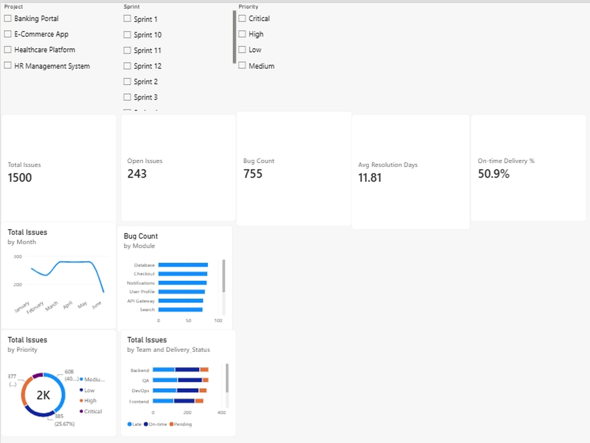
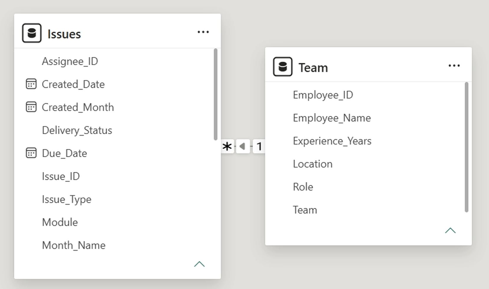

# IT Project Delivery & Bug Tracking Dashboard (Power BI)

An interactive Power BI dashboard that tracks ticket delivery, bug quality and team workload for a software organisation, similar to what a Jira export would show.

> Note: The dataset is **sample (simulated) data** created for learning and portfolio purposes. It does not belong to any real company.

## Business Problem
Project managers need to know: Are tickets delivered on time? Which modules produce the most bugs? How long do issues take to resolve? Which teams carry the most work?

## Dataset
- **Issues** (1,500 tickets after cleaning): Issue_ID, Project, Sprint, Issue_Type, Priority, Status, Module, Assignee_ID, Created_Date, Due_Date, Resolved_Date, Story_Points
- **Team** (24 employees): Employee_ID, Employee_Name, Role, Team, Experience_Years, Location
- Relationship: Team[Employee_ID] (one) to Issues[Assignee_ID] (many)

## Data Cleaning (Power Query)
- Removed 15 duplicate tickets using Issue_ID (1,515 to 1,500 rows)
- Standardised Priority text (high, HIGH, Medium etc.) to Critical, High, Medium, Low
- Replaced 12 missing Assignee_ID values with "Unassigned" instead of deleting rows
- Fixed data types (dates and whole numbers)
- Created new columns: Resolution_Days, Delivery_Status (On-time / Late / Pending), Created_Month, Month_Name

## DAX Measures
Total Issues, Open Issues, Bug Count, Avg Resolution Days and On-time Delivery % (see `DAX_Measures.txt`).

## Dashboard

- KPI cards: Total Issues, Open Issues, Bug Count, Avg Resolution Days, On-time Delivery %
- Monthly ticket trend (line chart)
- Bugs by module (bar chart)
- Issues by priority (donut chart)
- Delivery status by team (stacked bar chart)
- Slicers: Project, Sprint, Priority

## Data Model

## Key Insights (from the sample data)
1. 1,500 tickets in total, of which 243 (16%) are still open and 64 are blocked.
2. 755 tickets (about 50%) are bugs. Database, Checkout, Notifications and User Profile are the modules with the most bugs (78 to 83 each).
3. Only about 51% of closed tickets were delivered on time, so the on-time delivery rate needs improvement.
4. Critical tickets are resolved fastest (about 5 days on average) and Low priority slowest (about 16 days), which shows prioritisation is working. Critical tickets also have the best on-time rate (about 64%).
5. DevOps has the lowest on-time rate (about 49%) and Backend the highest (about 54%).
6. Ticket volume peaked in March to May (about 280 per month).

## Tools Used
Power BI Desktop, Power Query, DAX, Excel

## Files
- `IT_Project_Dashboard.pbix`: Power BI report
- `IT_Project_Data_Cleaned.xlsx`: cleaned dataset
- `DAX_Measures.txt`: all measures
- `Dashboard_Overview.pdf`: dashboard and data model as PDF
- `Screenshots/`: dashboard and data model images
